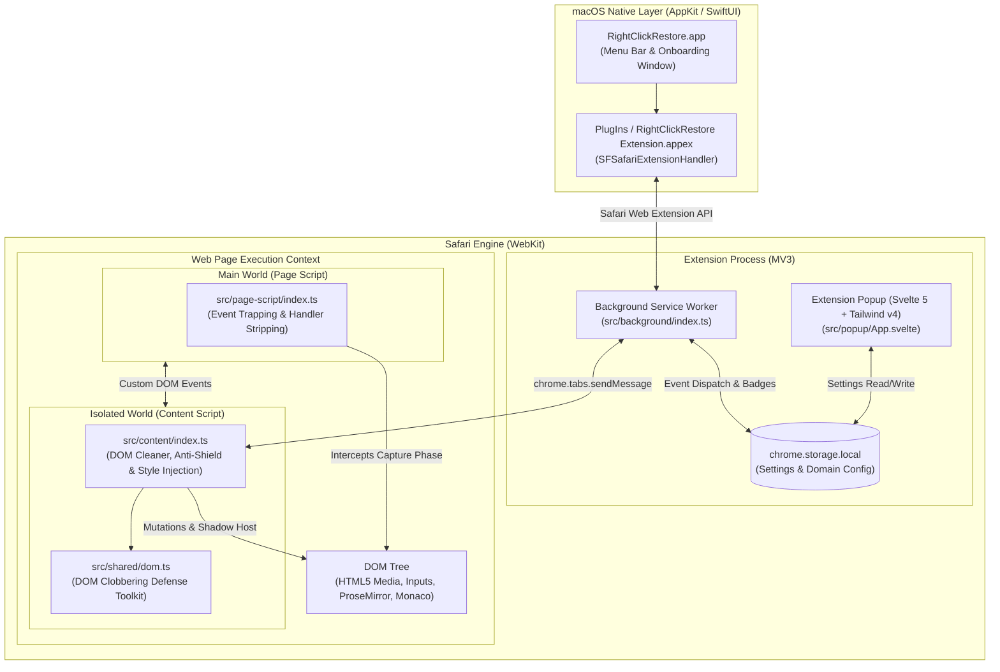
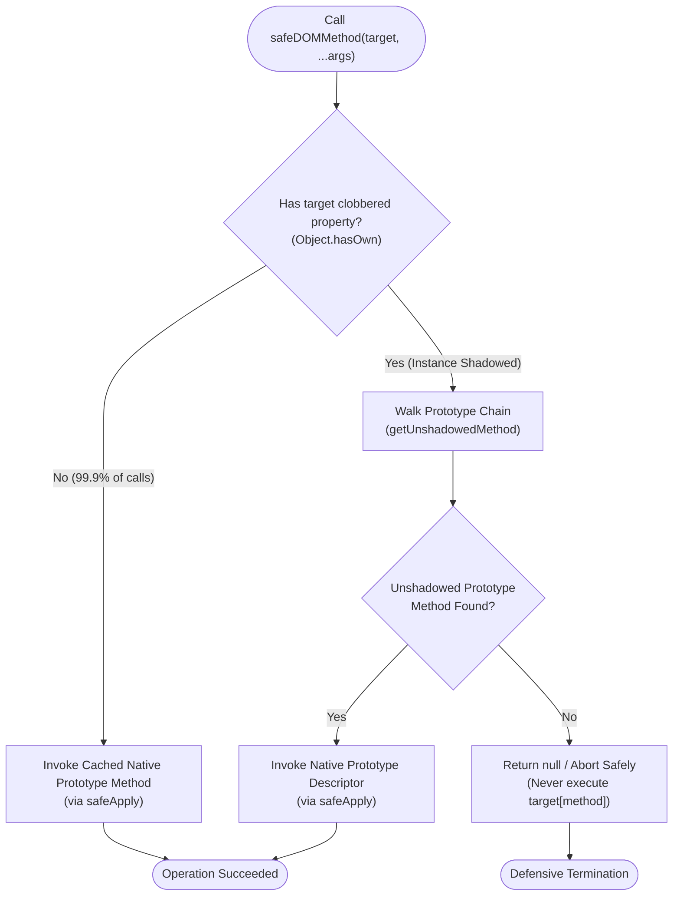
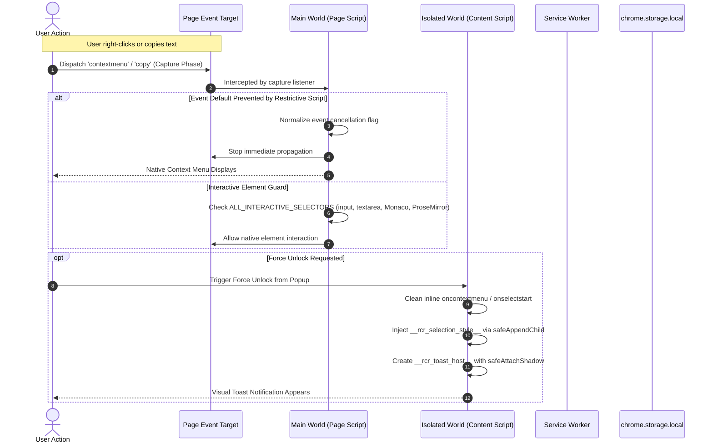
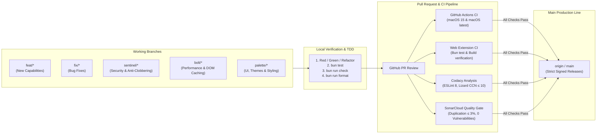

# Architecture & Git Workflow Specification 📐

Comprehensive architectural blueprint, security model, and Git development lifecycle for **RightClickRestore**.

---

## 1. Executive Summary & Design Principles

RightClickRestore is a dual-tier extension and companion application for macOS and Safari (Manifest V3) engineered to unblock copy, selection, context menus, and media interaction across restrictive web applications.

### Core Principles
- **Zero Trust DOM**: Untrusted page scripts frequently poison or clobber native DOM prototypes. RightClickRestore operates under the assumption that instance methods (`appendChild`, `querySelectorAll`, `attachShadow`, `getAttribute`) may be shadowed, spoofed, or overwritten by malicious forms or child elements.
- **Fail Closed & Safe**: Defensive routines never fall back to executing unknown instance properties. If an unshadowed native method cannot be resolved, the operation returns `null` or aborts safely.
- **Strict Boundary Separation**: Code runs across distinct execution environments (Main World, Isolated World, Service Worker, Popup, and Swift Companion App) with explicitly typed message interfaces.
- **High Performance / Low Latency**: Native DOM prototype references are captured at module evaluation time. Complex prototype chain walks are bypassed when standard instances do not possess shadowing properties.

---

## 2. High-Level System Architecture



---

## 3. WebKit Execution Contexts & Inter-Process Communication

RightClickRestore partitions responsibilities across four distinct runtime contexts to balance security, performance, and permission boundaries:

| Context | Script | Permissions / Scope | Key Responsibilities |
| :--- | :--- | :--- | :--- |
| **Main World** | [`src/page-script/index.ts`](file:///Users/marspater/Projects/right-click-restore/src/page-script/index.ts) | Unrestricted page JS access; no extension APIs. | Intercepts capture-phase `contextmenu`, `copy`, `cut`, `selectstart` events; disables inline handler properties (`oncontextmenu = null`). |
| **Isolated World** | [`src/content/index.ts`](file:///Users/marspater/Projects/right-click-restore/src/content/index.ts) | Access to DOM; isolated JavaScript global; limited Chrome extension APIs. | Injects user-select override styles; manages `MutationObserver` for video unblurring and anti-shield overlay bypass; displays closed-mode Shadow DOM toast. |
| **Service Worker** | [`src/background/index.ts`](file:///Users/marspater/Projects/right-click-restore/src/background/index.ts) | Full Web Extension APIs; no DOM access. | Manages persistent settings in `chrome.storage.local`; handles tab updates; routes broadcast messages across active tabs. |
| **Popup UI** | [`src/popup/App.svelte`](file:///Users/marspater/Projects/right-click-restore/src/popup/App.svelte) | Standard Web Extension popup; Svelte 5 Runes. | Controls global & per-site configuration; provides Force Unlock trigger; styled with Tailwind CSS v4 and macOS Liquid Glass aesthetics. |

---

## 4. DOM Clobbering Resistance Architecture

DOM Clobbering is an attack pattern where HTML forms or inputs containing specific `id` or `name` attributes shadow DOM properties on elements or the document (e.g. `<form id="appendChild">` or `<input name="querySelectorAll">`).



### Defense-in-Depth Mechanisms in `src/shared/dom.ts`:
1. **Module-Evaluation Initialization**: Native prototypes (`Element.prototype.getAttribute`, `Node.prototype.appendChild`, `Element.prototype.attachShadow`, `querySelectorAll`) are stored when the module loads, ahead of arbitrary page scripts.
2. **Function Application Detachment**: Functions are called using `safeApply`, which preferentially uses `Reflect.apply` or falls back to `Function.prototype.call.bind(Function.prototype.apply)`, preventing page scripts from spoofing `Function.prototype.apply`.
3. **Integer-Dispatched Node Type Queries**: `safeQuerySelectorAll` inspects `(root as Node).nodeType` directly (1 for Element, 9 for Document, 11 for DocumentFragment) to avoid high cyclomatic complexity while selecting the appropriate native prototype.
4. **No Insecure Fallbacks**: If instance properties are shadowed and prototype resolution fails, functions abort cleanly rather than calling `parent.appendChild(child)` or `element.attachShadow(init)`.

---

## 5. End-to-End Event Interception Sequence



---

## 6. Git Architecture & Branching Workflow

RightClickRestore enforces a disciplined Git lifecycle paired with automated quality gates and strict commit semantics.



### 1. Branch Naming Conventions
- `feat/<topic>`: Additions to core extension capabilities or UI.
- `fix/<topic>`: Regression and bug resolution.
- `sentinel/<topic>`: Security, DOM clobbering resistance, input sanitation.
- `bolt/<topic>`: Performance optimizations, caching, and prototype acceleration.
- `palette/<topic>`: Visual themes, macOS HIG adherence, Svelte/CSS refinements.

### 2. Commit Protocol
All commits follow the structured format:
```
<type>(<optional-scope>): <short description>
```
- **Allowed Types**: `feat`, `fix`, `refactor`, `perf`, `test`, `docs`, `chore`, `build`, `ci`.
- **Length**: Maximum 50 characters for the subject line.
- **Mood**: Imperative mood without trailing period (`fix(dom): resolve method bindings`).

### 3. Automated Quality Gates
Every Pull Request must satisfy:
1. **Zero Open Issues in Codacy**: Includes ESLint, Lizard cyclomatic complexity (CCN ≤ 10), and OWASP security rules.
2. **SonarCloud Quality Gate**: Zero vulnerabilities, zero security hotspots, and new code duplication density ≤ 3.0%.
3. **Cross-Platform Matrix**: Universal Apple Silicon (`arm64`) and Intel (`x86_64`) builds passing on `macos-15` and `macos-latest`.
4. **Clean Formatting**: `biome check` and `biome format` with zero discrepancies.
